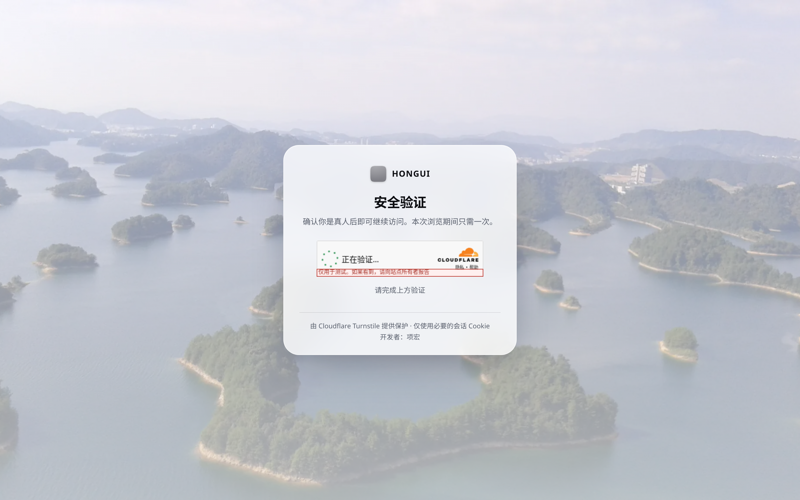
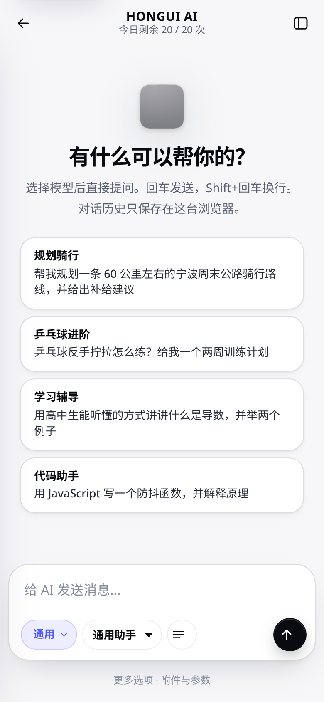

# HONGUI

HONGUI 是一个完全运行在 **Cloudflare Workers** 上的个人空间网站：博客、AI 对话与画图、网盘、测速与 IP 质量检测、后台管理、Cloudflare Turnstile 人机验证，以及一个独立的临时邮箱服务。单文件 Worker，无需服务器。

线上示例：<https://hongspaces.com> · 作者：项宏

 

## 功能

- **博客**：文章、自动目录、分享按钮、AI 生成的封面图
- **AI**：对话 + 画图，调用 NVIDIA API（兼容 OpenAI 接口），模型与参数可在后台 `/admin?tab=ai` 修改；独立子域 `ai.<你的域名>`，游客每日限额
- **网盘**：基于 R2，拖拽上传、大文件分片、文件夹、预览、批量操作、带有效期的分享链接
- **测速 / IP 质量**：下载、上传、延迟、抖动；识别家宽 / 移动 / 机房代理，检查 WebRTC 泄露与时区
- **Turnstile 人机验证**：进站验证，通过后 12 小时有效；脚本加载失败时以受限模式放行
- **后台**：管理文章、AI 设置等
- **响应式**：手机、平板、桌面单独适配，夜间模式，可切换的真实风景背景
- **临时邮箱**（`mail/`）：Email Routing + Worker + D1 + R2；一般邮箱约 24 小时清理，可选 PIN；本地部分以 `Hong` 开头（不区分大小写）的邮箱与邮件永久保留

## 架构

```
src/worker.js      主站 Worker（KV: one，R2: first）
mail/src/          临时邮箱 Worker（D1: DB，R2: MAIL_BUCKET，每小时 cron）
mail/schema.sql    D1 表结构
```

## 部署

```bash
npm i -g wrangler && wrangler login

# 主站
cp wrangler.example.toml wrangler.toml
wrangler kv namespace create one          # 把 id 填进 wrangler.toml
wrangler r2 bucket create your-drive-bucket
for s in ADMIN_USER ADMIN_SECRET SESSION_SECRET AI_KEY_GENERAL AI_KEY_IMAGE TURNSTILE_SECRET; do wrangler secret put $s; done
wrangler deploy

# 临时邮箱
cd mail && cp wrangler.example.toml wrangler.toml
wrangler d1 create your-mail-db           # 把 database_id 填进 wrangler.toml
wrangler d1 execute your-mail-db --remote --file=schema.sql
wrangler r2 bucket create your-mail-bucket
wrangler secret put CF_API_TOKEN          # 需要 Email Routing 编辑权限
wrangler deploy
```

本地开发：把 `.dev.vars.example` 复制为 `.dev.vars` 并填写，然后 `wrangler dev`。

### 需要自行配置的内容

- 域名：代码中的 `hongspaces.com` / `ai.hongspaces.com` 为原站域名，请搜索替换为你自己的域名。
- Turnstile：在 `wrangler.toml` 的 `[vars] TURNSTILE_SITEKEY` 填入站点密钥（公开），`TURNSTILE_SECRET` 用 secret 设置。默认值为 Cloudflare 官方测试密钥。
- 联系方式：页面中的 Telegram / 微信已替换为占位符 `your_telegram` / `your_wechat`，请在 `src/worker.js` 中搜索替换。作者名、关于页、文章内容是原站内容，可自行修改。
- 所有密钥只通过 `wrangler secret put` 设置，不要写进代码或 toml。

## 素材

背景照片来自 Wikimedia Commons（CC 协议），署名见代码中的 credits；文章封面由 AI 生成。

## English

HONGUI is a personal site running entirely on Cloudflare Workers: blog, AI chat & image generation (NVIDIA API), R2-backed drive, speed / IP-quality test, admin panel, Turnstile gate, plus a temp-mail worker (`mail/`). Copy `wrangler.example.toml` → `wrangler.toml`, create the KV / R2 / D1 resources, set secrets listed in `.dev.vars.example` with `wrangler secret put`, then `wrangler deploy`. Replace the `hongspaces.com` domain and the `your_telegram` / `your_wechat` placeholders with your own.

## License

MIT © 2026 项宏 (Hong Xiang)
